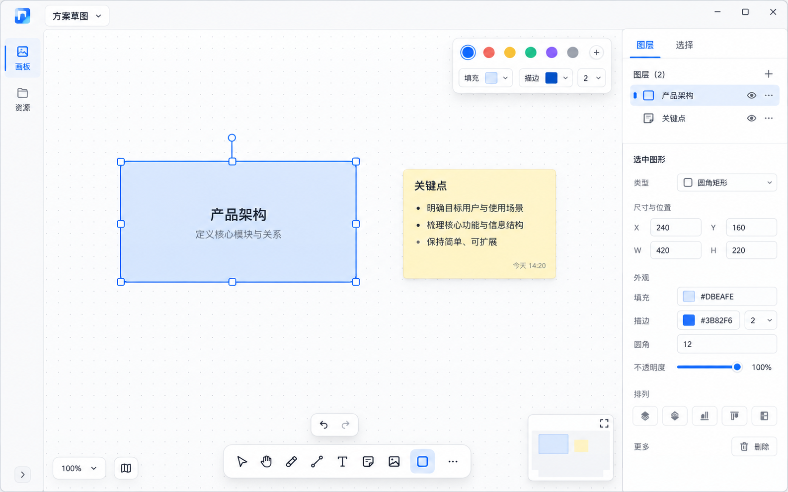

# FileAtlas Canvas — tldraw layout pass (2026-10-26)

This pass follows the actual blank editor opened at [tldraw.com](https://www.tldraw.com/)
and its official [UI component layout](https://tldraw.dev/sdk-features/ui-components).
The app presents an edge-to-edge infinite canvas, a compact document/menu area at top left,
contextual style controls at top right, a floating icon toolbar at bottom center, and zoom
navigation at bottom left. Undo/redo sits just above the drawing tools. FileAtlas keeps its
own board/resource browser and layer inspector as slim side columns around that canvas.

## Implementation checklist

- The single managed FileAtlas panel uses most of the host viewport while retaining resize,
  move, minimize/maximize and close behavior. The canvas gets the largest center column.
- Top bar: board name and compact icon actions for new, rename, import, export, remove and
  refresh. Tool names are available from button tooltips.
- Left rail: a narrow scrollable board list followed by the external-resource list. Selecting a
  board activates it; selecting a resource opens it through its provider/QuickLook path.
- Center: the embedded upstream canvas remains the only document renderer. Main tools use one
  compact floating icon toolbar centered near the bottom; undo and redo float directly above.
  Color, font and template controls sit at the canvas upper-right and continue to open the
  existing engine controls. Zoom/navigation remains upstream-owned at the lower-left.
- Right: a narrow layer/selection inspector remains inside the FileAtlas host panel. Layer
  order, selection, geometry readout and reorder actions retain their existing semantics.
  When an Eagle image is selected, extend its property details below geometry with Eagle
  item name/ID, assigned folders, original path and FileAtlas URI, thumbnail path, and the
  Eagle Web API item URL. Other selected objects retain the existing compact properties.
- Theme colors, button states, borders, radii and shadows all come from GPUI Kit Theme and UI
  Bridge components. The canvas dot grid and user artwork remain document rendering.
- Default state: the active board and drawing tools are visible with a broad canvas. Selected
  tool uses the shared accent selection state; menus and pickers appear only when opened.
  No selection shows the layer list and “未选择图层”. Save status and errors remain at the foot.
- Small windows keep the columns scrollable, keep the bottom tools in the canvas viewport where
  possible, and allow the host panel's existing resize/minimum-size behavior.

## 2026-10-26 user-requested side-panel clarity pass

The attached running-window screenshot showed percent-encoded resource names, repeated text reorder
buttons that overflow the inspector, and long Eagle paths/URIs dominating the properties area. The
supplementary concept is [compact side-panel concept](fileatlas-canvas-inspector-compact-2026-10-26.png).

Implementation checklist:

- Keep the center canvas and its toolbar geometry unchanged; side panels remain separate scrollable
  columns using shared UI Bridge/GPUI Kit surfaces and controls.
- Left board and resource rows use a compact leading type icon, a human-readable decoded title, and
  one short secondary parameter (resource type/extension); never expose an encoded URI as the row
  title. Truncate long titles and make the full decoded title available through a tooltip.
- Right layer rows use a leading element-kind icon and a flexible, truncated human-readable label.
  Reorder uses compact icon-only up/down buttons in the same row, with tooltips/accessibility labels
  and disabled boundary states; preserve the existing selection and reorder actions.
- Properties use icon/value rows for name, dimensions, position, Eagle folder and source data.
  Long filesystem locations show a short useful tail and expose the complete value by tooltip and a
  copy action. Original resource URI and Eagle API URL are represented by concise labels with copy
  actions instead of raw wrapped URL paragraphs. Eagle item ID stays available as a parameter.
- Selected and hover rows retain native theme states; empty selection, long filenames, nested folder
  names, and non-Eagle image properties remain readable. Long property content scrolls with the
  existing inspector rather than shrinking the canvas text scale.
- This is a targeted visual pass: the concept's search/filter tabs and extra board actions are not
  part of this implementation; canvas tools, drawing semantics, board persistence and resource
  opening behavior stay unchanged.

## Behavior boundaries

The drawing toolbar still delegates every drawing operation to the copied MIT canvas engine.
FileAtlas owns document actions, board/resource navigation, extension commands and layer
inspection. This layout does not claim that a video card has an embedded player, or that the
inspector can edit every engine style.

The prior `fileatlas-canvas-workspace-2026-10-26.png` concept described the first three-column
prototype. This tldraw-informed reference supersedes its top-toolbar placement and panel sizing;
its left-resource/center-canvas/right-inspector concept remains useful.
