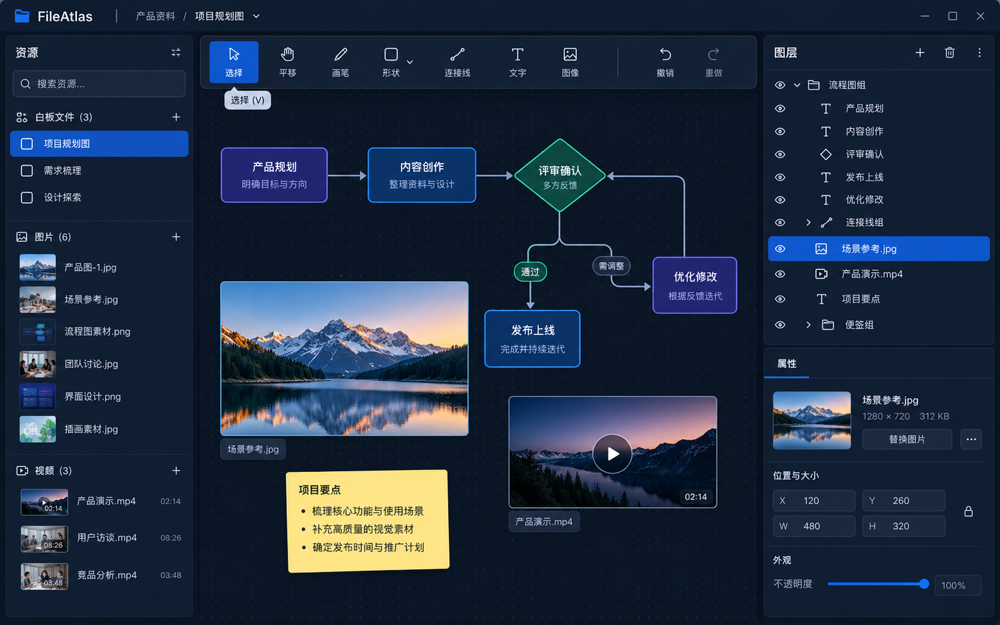

# FileAtlas 插件化画布工作区（2026-10-26）

本稿由用户指定的 tldraw 类工作区方向生成，用户明确要求将 `gpui-whiteboard`
现有实现代码复制并整合进 FileAtlas 自有分层，不保留其外部库依赖。图像是结构与视觉层级参考，
不是逐像素规格；照片、文案和视频帧均为示意内容。

## 实现清单

- 一个 FileAtlas 面板作为唯一画布入口；主体使用左资源区、中间无限点阵画布、右图层/属性区。
- 画布上方只有一条 FileAtlas 工具栏；包含选择、平移、文字、形状组、笔/连接线组、资源组、
  颜色、字体、模板及唯一撤销/重做入口。上游 View 的内置浮动工具栏隐藏。
- 左侧列出画板及媒体资源。图片复用现有缩略图/图片解码路径；本地文件经共享 ResourceProvider
  生成稳定 URI。视频可以插入为视频标记的文件卡片、选择并重新排序，打开仍交给资源提供方或 QuickLook。
- 右侧图层按场景绘制顺序排列，支持选择、上移和下移；属性编辑仍使用上游现有选中对象交互。
  首期不暴露隐藏/锁定，因为上游 Scene 没有这两个稳定字段。
- 主题只走 GPUI Kit Theme 角色和 UI Bridge 组件。场景内颜色是实际文档数据；上下文菜单、颜色/字体/模板
  编辑器复用引擎现有交互并通过主题适配。
- 工具组和元素类别按用户使用流程组合；不按每种图形新建 Cargo/Cordis 插件。

## 分层与兼容

`fileatlas-canvas-engine` 是 FileAtlas 内部引擎 crate，源码来自锁定的 MIT
`gpui-whiteboard 0.5.1` 包，不再依赖外部 `gpui-whiteboard`。它拥有 Scene JSON、相机映射、
输入、命中、编辑/变换、绘制和统一撤销/重做；本轮只添加 FileAtlas 嵌入模式、图层读取/选择/重排入口。
`fileatlas-plugin-whiteboard` 负责画布产品面板、资源浏览、工具栏、图层面板与宿主回调；Cordis
仍管理其启停，UI Bridge 管理其生命周期 UI 注册。

Scene JSON 继续原样保留原始字段，既有 Zorite Scene 导入/导出和绝对图片路径兼容继续有效。
FileAtlas 的 `library.json` 仍是版本 2，已有 v1 `path` 到 v2 `uri` 迁移、原子写入、`.bak` 恢复，
新增功能不改写 SQLite 或媒体数据。MIT 许可、上游提交、图标和字体许可证见引擎 crate 归属记录。

## 本轮覆盖差异

概念显示搜索框、属性编辑器、图层显隐/锁定、嵌套分组、视频时长与内嵌播放。本轮只完成资源列表、
资源插入、视频文件卡片标记、图层选择和上下移；搜索、完整属性编辑、嵌套分组、显隐/锁定和内嵌播放
仍未实现，不以概念图替代完成声明。运行截图对照记录在 `docs/validation-ui/2026-10-26-fileatlas-canvas/`。
