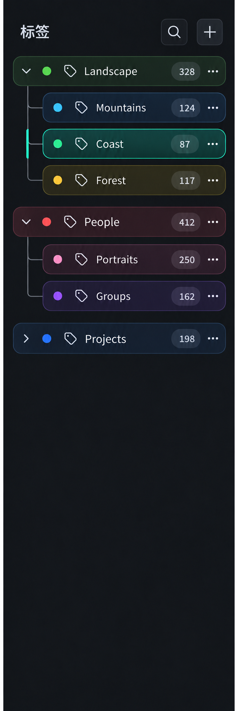

# 标签侧栏颜色胶囊概念 — 2026-10-16

来源：按用户反馈生成的界面视觉参考。用于此次标签侧栏胶囊样式调整。

视觉要点：

- 每个标签行独立呈现为胶囊，靠底色、细边框和间隙清楚分组。
- 胶囊底色使用对应标签本身的颜色，控制饱和度以保持深色界面中的文字对比度。
- 选中态增强同一标签色，而不是统一换成全局蓝色。
- 计数徽标在固定的右侧位置对齐；“…”操作按钮保持可见。
- 父子缩进和连续连接线说明树形关系，标签行中的颜色点辅助快速识别。

概念图用于视觉层级、色彩、间距和状态方向，不作为 GPUI 的逐像素规格；运行效果通过同进程 FileAtlas MCP 截图复核。
